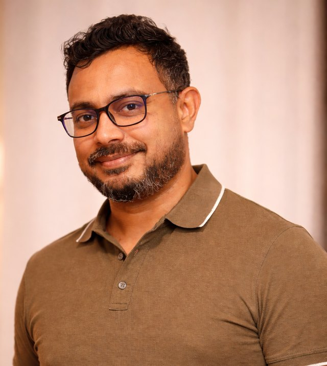

::: {.hero}
::: {.hero-grid}
::: {}
::: {.eyebrow}
Statistical Consulting
:::

# Good answers start with the design.

::: {.lede}
I'm an accredited professional statistician (P.Stat.) and Associate Professor. I help researchers, teams, and organizations design studies properly, model data honestly, and report results plainly, from the first power calculation to the final dashboard.
:::

[Work with me](consulting.qmd){.btn-cta .primary}
[Email me](mailto:consulting@rckaruna.ca?subject=Statistical%20consulting%20enquiry&body=1.%20The%20question%20I%20am%20trying%20to%20answer%3A%0A%0A%0A2.%20The%20data%20%28planned%2C%20being%20collected%2C%20or%20in%20hand%29%3A%0A%0A%0A3.%20My%20deadline%3A%0A%0A%0A4.%20Who%20will%20use%20the%20result%20%28committee%2C%20journal%2C%20funder%2C%20management%29%3A%0A%0A%0A5.%20Ethics%20board%20or%20grant%20involved%20%28yes%20or%20no%29%3A%0A%0A){.btn-cta .ghost}

::: {style="margin-top:1rem"}
[`study design`]{.tag} [`DOE`]{.tag} [`mixed models`]{.tag} [`reliability`]{.tag} [`AI evaluation`]{.tag} [`R / Shiny`]{.tag}
:::
:::

::: {.hero-side}
{.hero-photo fig-alt="Ruwan C. Karunanayaka"}

::: {.card-plain}
### What clients get
A sound answer, not just a number: the right design for the question, methods chosen for the data rather than habit, uncertainty stated plainly, and a writeup or interactive tool your stakeholders can use.
:::
:::
:::
:::

::: {.band .dark}
::: {.eyebrow}
Credentials
:::
## Grounded in peer-reviewed work.

::: {.cols-3}
::: {.card-plain}
### Training & position
PhD in Statistics (Simon Fraser University, 2018). Associate Professor, Department of Mathematics & Statistics, University of the Fraser Valley. Honorary Visiting Professor, Centre for Health Economics Research and Evaluation, University of Technology Sydney (2026).
:::
::: {.card-plain}
### Published methods
Peer-reviewed research in experimental design and applied statistics, with methods independently cited across textile engineering, food science, hydrology, and mining research.
:::
::: {.card-plain}
### Accreditation
P.Stat. (Professional Statistician), accredited by the Statistical Society of Canada. SSC member since 2017.
:::
:::
:::

::: {.band}
::: {.eyebrow}
What I help with
:::
## Three services, one standard.

::: {.cols-3}
::: {.card-plain}
### Study & experiment design
Sample size and power, randomization, factorial and fractional-factorial designs, including the baseline parameterization, so the data you collect can answer your question.
:::
::: {.card-plain}
### Modelling & analysis
Mixed-effects and generalized linear models, measurement reliability, calibration and validation. Documented, reproducible, reviewable.
:::
::: {.card-plain}
### Tools & dashboards
Interactive R / Shiny applications that put your model in front of the people who need to act on it. See a [live example](projects.qmd).
:::
:::
:::

::: {.band .dark}
::: {.eyebrow}
Statistics for the AI era
:::
## Your AI is only as good as its evaluation.

Benchmark scores drift with the test harness, top-of-leaderboard gaps sit inside statistical noise, and most evaluation pipelines are never checked for reliability. Before an AI number drives a decision, such as which model to buy or whether a system is ready to ship, someone should ask whether the measurement itself can be trusted. That's measurement science, and it's what I do.

::: {.cols-3}
::: {.card-plain}
### Evaluation design & audit
Design AI evaluations that answer the question, with proper sampling, contamination control, and uncertainty on every comparison. Or audit the one you have.
:::
::: {.card-plain}
### Reliability of judgments
Human raters and LLM-as-judge pipelines are measurement instruments. I quantify their dependability and tell you how many judgments a trustworthy verdict needs.
:::
::: {.card-plain}
### Experiments that respect your budget
When every evaluation run costs money, designed experiments get you more answer per dollar than one-at-a-time testing of prompts, configurations, and models.
:::
:::

[AI services in detail →](consulting.qmd#statistics-for-ai-systems){.btn-cta .primary style="margin-top:1.4rem"}
:::

::: {.band}
::: {.eyebrow}
Beyond consulting
:::
## Research, software, and teaching.

::: {.cols-3}
::: {.card-plain}
### Projects
A live forecasting tool and open-source software: working demonstrations of the tools I build.
[Explore →](projects.qmd)
:::
::: {.card-plain}
### Research
Published work in experimental design and applied statistics, with an active research program in measurement reliability.
[Publications →](research.qmd)
:::
::: {.card-plain}
### Blog
Short posts on how to design studies, measure reliably, and trust the numbers.
[All posts →](blog.qmd)
:::
:::
:::

::: {.band .dark .cta-band}
::: {.eyebrow}
Get in touch
:::
## Have a study, a dataset, or a decision to make?

Tell me the question you are trying to answer and where the data stands. The earlier I am involved, the more I can help.

[Email me →](mailto:consulting@rckaruna.ca?subject=Statistical%20consulting%20enquiry&body=1.%20The%20question%20I%20am%20trying%20to%20answer%3A%0A%0A%0A2.%20The%20data%20%28planned%2C%20being%20collected%2C%20or%20in%20hand%29%3A%0A%0A%0A3.%20My%20deadline%3A%0A%0A%0A4.%20Who%20will%20use%20the%20result%20%28committee%2C%20journal%2C%20funder%2C%20management%29%3A%0A%0A%0A5.%20Ethics%20board%20or%20grant%20involved%20%28yes%20or%20no%29%3A%0A%0A){.btn-cta .primary}
[How an engagement works](consulting.qmd#how-an-engagement-works){.btn-cta .ghost-light}
:::
