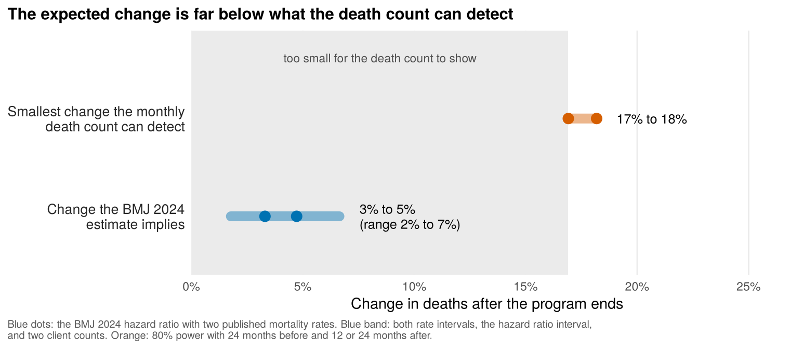

On November 24, the Premier's mandate letter directed the Minister of Health to end the "safe supply" approach to drug use [1]. The letter gives no date and no transition plan.

When the program ends, the monthly count of drug deaths in British Columbia will go up or it will go down. Either way, the movement will be read as evidence about the program. I downloaded the public data and worked out what that count can show. The answer is that it cannot show the effect of ending the program, in either direction, even if the main published estimate of the program's benefit is exactly right.

This post takes no position on whether the program should end. It is about what we will be able to learn afterwards.

## The program is small next to the count it will be judged by

The program is officially called prescribed alternatives. It began in March 2020 and gives people at risk from the unregulated supply a prescribed medication, most often hydromorphone tablets.

The BC Centre for Disease Control publishes monthly counts [2]. The number of people dispensed a prescribed alternative peaked at 5,189 in March 2023. It was 3,888 in September 2026. Over the 12 months to September 2026, 1,576 people in the province died from unregulated drugs.

![British Columbia, monthly. The lower panel counts people dispensed a prescribed alternative at least once in the month. Dotted lines mark the declaration of the public health emergency, the start of the program in the first weeks of the pandemic, a widening of eligibility that came with a new billing code, the requirement that new patients take doses under supervision [6], and its extension to all patients, which also came with new billing codes [7]. The count after December 2025 is not comparable with the count before, for the reason given below.](deaths-and-clients.png){fig-alt="Two line charts for British Columbia from 2015 to 2026, with five dotted vertical lines at April 2016, March 2020, January 2022, February 2025, and December 2025. Monthly unregulated drug deaths rise to about 240 in 2023 and fall to about 130 in 2026. People dispensed prescribed alternatives rise sharply in early 2022, peak at 5,189 in March 2023, fall to about 3,000 in 2025, and are 3,888 in September 2026."}

One feature of the figure needs a caution. The guidance that created the program was issued on March 26, 2020, as a pandemic measure [3]. Monthly deaths rose from 79 in February 2020 to 189 in June. The program had 569 clients that June. The program and the rise in deaths began in the same weeks, and the figure cannot separate the two. It should not be read as showing that either one caused the other.

## What the BMJ estimate implies

The main evidence on the program's benefit for the people who receive it is a 2024 study in the BMJ [3]. It used linked health records for 5,356 people with opioid use disorder who were dispensed opioids under the program between March 2020 and August 2021, and matched each of them to a similar person who was not. In the week after a week with dispensing, the risk of death from any cause was 61% lower. The adjusted hazard ratio was 0.39, with a 95% confidence interval from 0.25 to 0.60.

The study is observational, and an observational estimate can be wrong. The authors note that they could not tell whether the medications were used as prescribed or passed to other people. I set that debate aside here and ask a narrower question. Suppose the estimate is exactly right. How many deaths does it imply?

That needs the death rate among comparable people who are not dispensed the medication. Two BC studies report one.

| Source | Group | Period | Deaths per 100 person-years |
|---|---|---|---|
| BMJ 2024, Table 2 [3] | Matched comparison group, not dispensed | March 2020 to August 2021 | 3.5 |
| BMJ 2020, Table 2 [4] | People with opioid use disorder, while off opioid agonist treatment | 1996 to 2018 | 2.4 |

: Published death rates used in this post. The first is 207 deaths over 310,767 person-weeks, converted to years. {#tbl-rates}

From April to September 2026, an average of 3,505 people a month were dispensed a prescribed opioid. At 3.5 deaths per 100 person-years, about 122 of them would be expected to die in a year without the medication. With a hazard ratio of 0.39, about 48 would. The difference is 74 deaths a year. With the older rate it is 52.

So if the BMJ estimate is exactly right, ending the program adds between 52 and 74 deaths a year. That is 3% to 5% of the provincial total. When I carry through the uncertainty in the hazard ratio and in both rates, the range is 2% to 7%.

This calculation is generous to the program. The study's estimate is for weeks in which a person was dispensed the medication. I applied it to every month in which a person appears in the count.

## What the death count can detect

Fifty-two to 74 deaths a year is four to six a month. Over the last two years, the province recorded an average of 144 deaths a month, and the count varies around its trend by about 13 deaths a month through chance alone.

I simulated the best case for an analyst. The recent trend continues unchanged. Deaths step up by a fixed percentage on the day the program ends. The analyst knows the right model and has 24 months of data before and 12 or 24 months after.

Under those conditions, the smallest step that would be detected four times in five is about 18% with one year of follow-up and 17% with two. A step of 3% to 5% would be detected about one time in ten.

{fig-alt="Chart with two rows. The change implied by the BMJ 2024 estimate is 3 to 5 percent, with a range of 2 to 7 percent. The smallest change the monthly death count can detect is 17 to 18 percent. Everything below 17 percent is shaded and labelled too small for the death count to show."}

More years of follow-up do not help much, because the step and the trend have to be estimated from the same series. Real conditions are also worse than the simulation. Annual deaths fell 10% from 2023 to 2024 and 21% from 2024 to 2025. A change of 3% to 5% is small beside movements of that size.

## The conclusion does not depend on the death rate

The rates in the table are from 2020–21 and from 1996 to 2018. I did not find a published rate for 2026, so I checked whether the conclusion needs one.

It does not. Suppose prescribed alternatives prevented every death among the people receiving them. For the end of the program to be detectable, those 3,505 people would then need a death rate of about 8 per 100 person-years without the medication. That is more than twice the higher published rate.

Read the other way, at the BMJ study's rate and hazard ratio, the program would need about 13,000 people on prescribed opioids for its end to show in the provincial count. The most it ever had was 4,945.

This cuts in both directions. A person who thinks the program does nothing expects no visible change in deaths when it ends. A person who thinks the BMJ estimate is right should expect the same thing. If deaths fall afterwards, that will not show the program was doing harm. If they rise, that will not show it was protecting people.

It also bears on what has been published. A 2024 comparison of British Columbia with Manitoba and Saskatchewan found more hospitalizations for opioid poisoning after the policy began and no statistically significant change in deaths [5]. Its 95% confidence interval for the change in deaths ran from −1.3 to 4.5 per 100,000 people per quarter. By my arithmetic, the BMJ estimate implies a reduction in 2021 of about 0.2 on that scale, which is far inside the interval. A study of provincial totals had little chance of finding an effect on deaths that small, in either direction.

## A caution on the client counts

The count of people in the program is the other number that will be watched, and it has changed its definition more than once. Codes that pharmacists enter are part of how a prescription is identified as belonging to the program. New codes were introduced in January 2022, June 2025, and December 2025.

The count rose from 3,011 in November 2025 to 3,888 in September 2026. The BCCDC's data notes attribute the increase that began in December 2025 to the new billing codes for witnessed doses [2]. At least part of that rise is a change in counting, and I cannot say how much.

## What this does not show

It does not show that the program works, and it does not show that it fails. The calculation takes the BMJ estimate as given only to ask what would follow from it.

It says nothing about diversion. The public data have no information on it.

It does not give the death rate among these patients in 2026. The published rates are several years old, which is why one section of this post does without them.

It does not cover outcomes other than death. The number of people on opioid agonist treatment is a steadier series, and a change of about 2% there would be detectable.

It does not say what will happen to any individual who loses a prescription.

## What would settle it

1. The province holds linked health records of the kind the BMJ study used. Following the people who were receiving a prescribed alternative after the program ends, beside a comparison group, would answer the question that the provincial count cannot. Under the published numbers, the difference among 3,505 people is 48 deaths against 122 in a year. A difference of that size would be clear.
2. A phased end, by region or by medication, would give a comparison that a single date does not.
3. The province could publish monthly new starts, discontinuations, and the share of doses witnessed, alongside the client count.

I have written an analysis plan for the period after the program ends. It fixes the outcomes and the methods before any implementation date is known, and it is available on request.

The data are from the BCCDC dashboard. The inferences are mine and do not reflect the views of the BCCDC or the data stewards. The R scripts behind every number in this post are available on request. If you find an error, please [tell me](mailto:consulting@rckaruna.ca).

## References

1. Office of the Premier of British Columbia. [Mandate letter to the Minister of Health](https://www2.gov.bc.ca/assets/gov/government/ministries-organizations/premier-cabinet-mlas/minister-letter/mandate_letter_ryan_peterson.pdf). November 24, 2026.
2. BC Centre for Disease Control. [Unregulated Drug Poisoning Emergency Dashboard](https://reporting.bccdc.ca/drug_poisoning_dashboard/). Data refreshed November 10, 2026, downloaded November 27, 2026. Data notes dated September 17, 2026.
3. Slaunwhite A, Min JE, Palis H, et al. [Effect of Risk Mitigation Guidance for opioid and stimulant dispensations on mortality and acute care visits during dual public health emergencies: retrospective cohort study](https://www.bmj.com/content/384/bmj-2023-076336). *BMJ* 2024;384:e076336.
4. Pearce LA, Min JE, Piske M, et al. [Opioid agonist treatment and risk of mortality during opioid overdose public health emergency: population based retrospective cohort study](https://www.bmj.com/content/368/bmj.m772). *BMJ* 2020;368:m772.
5. Nguyen HV, Mital S, Bugden S, McGinty EE. [British Columbia's Safer Opioid Supply Policy and Opioid Outcomes](https://jamanetwork.com/journals/jamainternalmedicine/fullarticle/2814103). *JAMA Internal Medicine* 2024;184(3):256–264.
6. BC Ministry of Health. [News release 2025HLTH0008](https://news.gov.bc.ca/releases/2025HLTH0008-000127), February 19, 2025.
7. BC Ministry of Health. [News release 2025HLTH0099](https://news.gov.bc.ca/releases/2025HLTH0099-001183), December 2, 2025.
