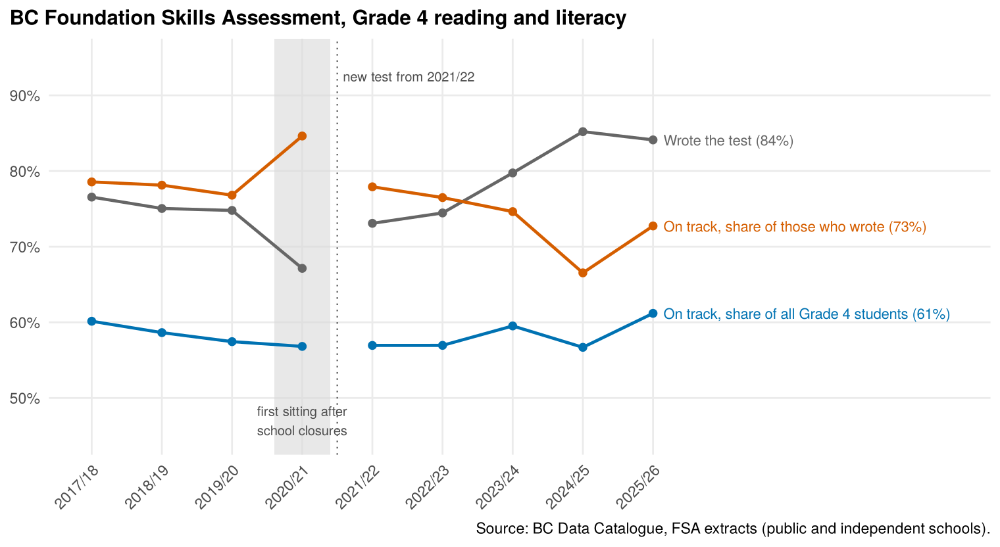
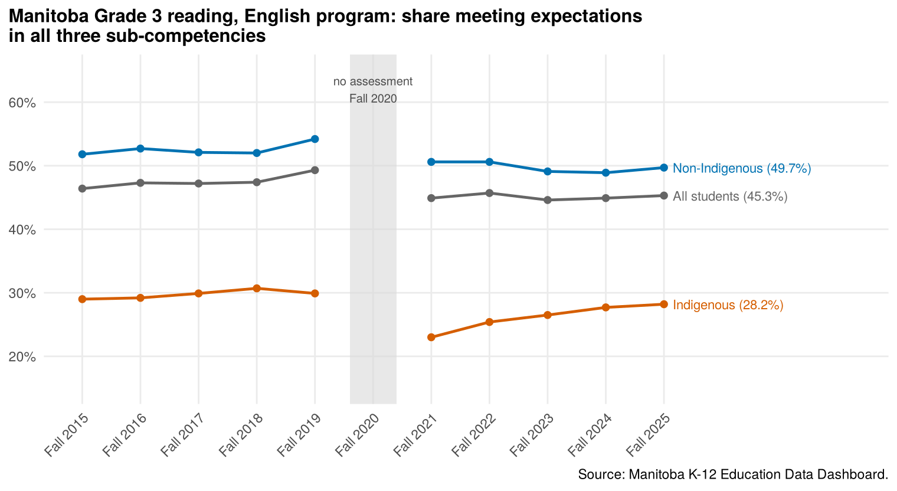

On November 25, CTV News reported on two papers from the Aristotle Foundation for Public Policy [3]. The first is titled "One in Three 9-Year-Old Canadians Cannot Read" [1]. The second says that, depending on the province, between 20 and 56 percent of students cannot read by Grade 4 [2].

I downloaded the public data behind the provincial figures for British Columbia, Manitoba, and Ontario, and worked through them. The concern in the reports is a fair one. A large share of young students are below their province's standard, and in Manitoba and Ontario the share grew after the pandemic. The headline numbers, however, do not measure one thing. They come from different tests, different years, and different denominators, and the range from 20 to 56 says more about those differences than about reading.

## Seven provinces, seven yardsticks

The first report's Figure 2 places seven provinces side by side under the label "most recent year." The report notes that Grade 3 and Grade 4 results "are not perfectly comparable" [1]. The differences go further than the grade.

| Province | Report's figure | What it measures | Year |
|---|---|---|---|
| Alberta | 20% | Below the Intermediate benchmark on an international test (PIRLS) | 2021 |
| British Columbia | 30% | Not "on track" on the Grade 4 provincial test, public schools, among students who wrote | 2025/26 |
| Ontario | 38% | Did not meet the Grade 3 standard without assistance, as computed by the Ontario Human Rights Commission | 2018–19 |
| Manitoba | 56% | Did not meet expectations in all three reading sub-competencies, as judged by the classroom teacher early in Grade 3 | Fall 2024 |

: The figures for four of the seven provinces, with what each one counts. {#tbl-yardsticks}

Alberta's 20% is the share below the Intermediate benchmark. On the same test, about 5% of Alberta students were below the Low benchmark [10]. "Cannot read" fits neither number well, and it fits the first one poorly.

Manitoba's assessment is the furthest from the others. It is classroom-based, it is done early in the school year, and a student counts as meeting expectations only if the teacher judges that all three sub-competencies are met [5]. A student who meets two of three is counted with those who meet none. That rule produces a low percentage by construction. It does not make Manitoba's result unimportant, and I return to it below.

Ontario's figure is seven years old. The Education Quality and Accountability Office (EQAO) has published four rounds of results since then. In 2025–26, 75% of fully participating Grade 3 students met the reading standard [6]. A representative of Dyslexia Canada made the same point in the CTV story [3].

## In British Columbia, the answer depends on who wrote the test

The report does not give a year for BC's 30%. The open data reproduce it: 30.2% of Grade 4 students in public schools were not on track in literacy in 2025/26 [4]. With independent schools included, the figure is 27.3%.

Those percentages are shares of the students who wrote. In BC that matters, because many students do not write the Foundation Skills Assessment, and the number who do has changed.

{fig-alt="Line chart of BC Grade 4 FSA results from 2017-18 to 2025-26. Participation falls to 67% in 2020-21, then rises to 85% in 2024-25 and 84% in 2025-26. The published on-track rate among writers falls from 78% in 2021-22 to 67% in 2024-25 and is 73% in 2025-26. The on-track share of all Grade 4 students stays between 57% and 61% throughout."}

Between 2021/22 and 2024/25, the published not-on-track share rose from 22% to 34%. Over the same years, participation rose from 73% to 85%. Counted as a share of all Grade 4 students expected to write, the on-track group stayed between 57% and 61% in every year from 2017/18 to 2025/26.

I cannot tell from these files how much of the rise is a decline in reading and how much is the arrival of students who would not have written in earlier years. The published rate alone cannot separate the two. A year-to-year comparison of that rate, without the participation figure beside it, is not safe.

## Ontario changed its denominator in 2022

Before the pandemic, EQAO reported the share of all Grade 3 students who met the standard. Since 2021–22, it reports the share of fully participating students [8]. EQAO restated its 2018–19 result on the new basis when it made the change [9]. I computed the 2021–22 result on the old basis from EQAO's published counts [6].

| Denominator | 2018–19 | 2021–22 | Change |
|---|---|---|---|
| Fully participating students | 77% | 73% | −4 points |
| All students | 74% | 67% | −7 points |

: Ontario Grade 3 reading, share meeting the provincial standard, English-language schools. {#tbl-ontario}

A reader who compares the 74% published in 2019 with the 73% published in 2022 would conclude that almost nothing happened. Both like-for-like comparisons show a drop.

The drop was not even. I followed about 2,600 English-language schools that have results before and after. On the all-students basis, Grade 3 reading fell by about 5 points in the third of schools with the fewest low-income families and by about 9 points in the third with the most [6, 7]. By 2024–25 the gap from the pre-pandemic level had narrowed to about 3 and 6 points.

One caution applies to all of these comparisons. Ontario moved from a paper test to an online adaptive test between 2019 and 2022. The change in the numbers is the pandemic and the change of test together.

## Manitoba has the cleanest record of the pandemic

Manitoba used one assessment and one reporting rule from Fall 2015 to Fall 2025, with no assessment in Fall 2020 [5]. No other province I examined offers that.

{fig-alt="Line chart of Manitoba Grade 3 reading from Fall 2015 to Fall 2025. All students: about 47% before the pandemic, 49.3% in Fall 2019, 44.9% in Fall 2021, and 45.3% in Fall 2025. Non-Indigenous students: 54.2% in Fall 2019, 50.6% in Fall 2021, 49.7% in Fall 2025. Indigenous students: 29.9% in Fall 2019, 23.0% in Fall 2021, 28.2% in Fall 2025."}

The provincial share was 49.3% in Fall 2019 and 44.9% in Fall 2021. It was 45.3% in Fall 2025. Against the trend of the five years before the pandemic, the drop is about 5 points, and the provincial figure has not recovered.

Among Indigenous students the share fell from 29.9% to 23.0%, and it has since risen to 28.2%. Among non-Indigenous students it fell from 54.2% to 50.6%, and it was 49.7% in Fall 2025.

This is a teacher's judgment against a rubric. A shift in the series could be a shift in how teachers apply the rubric. I have no evidence that this happened, and the size and timing of the drop are what the pandemic would produce.

## One year of results does not rank schools

The reports discuss provinces, but the same data are used to compare schools and districts, so I checked how dependable a single year is.

In Ontario, a school's Grade 3 reading percentage in one year has a reliability of about 0.62 for ranking schools across the province. An average over three years reaches about 0.83. The median school has 33 students in Grade 3, and a percentage based on 33 students moves several points from year to year when nothing about the school has changed.

In BC, about four in five year-to-year changes in a school's mean score are within the range that the sampling of students alone would produce.

## What this does not show

It does not show that literacy is fine. In Ontario, 25% to 30% of Grade 3 students do not meet the provincial reading standard, depending on the denominator. In Manitoba, more than half of Grade 3 students do not meet all three expectations early in the year. These are large numbers on any reading.

It does not test the reports' argument about how reading should be taught. Nothing here compares structured literacy with other approaches. The reforms are recent, and the students taught under them have not yet reached the tests that would show an effect.

It does not measure a pandemic effect in BC. In 2020/21, the first sitting after the closures, participation fell to 67% and the rate among writers rose. The test then changed. The BC data cannot settle the question in either direction.

It does not check the second report's statement that Grade 10 students are two to three years behind their peers of 25 years ago. The source given for that statement is another paper by the same authors, listed as forthcoming [2].

## What would settle it

Three things would help.

1. Every province could publish counts alongside percentages: students enrolled, students who wrote, and students who met the standard. Ontario does this now. BC masks most of these counts at the school level.
2. A common yardstick exists. Students in several provinces wrote the PIRLS Grade 4 reading assessment in spring 2026, and the international results are due in December 2027. Those students are the first to be assessed internationally after the recent curriculum changes.
3. Reports that compare provinces could state, for each number, the test, the year, and the denominator.

The international assessments are the subject of a [second post](../reading-at-15/index.qmd). The R scripts behind every number in this post are available on request. If you find an error, please [tell me](mailto:consulting@rckaruna.ca).

## References

1. Livingstone D, Hunt D, Tran P. [*One in Three 9-Year-Old Canadians Cannot Read*](https://aristotlefoundation.org/wp-content/uploads/2026/11/26-11-13_Livingstone_Hunt_Reality-Check_One-in-three-9-year-olds-cannot-read.pdf). Reality Check. Aristotle Foundation for Public Policy, November 13, 2026.
2. Livingstone D, Hunt D, Tran P. [*Why Literacy Is at an All-Time Low—and What to Do About It*](https://aristotlefoundation.org/wp-content/uploads/2026/11/26-11-18_Livingstone_Hunt_Tran_Reality-Check_Literacy-at-an-all-time-low-1.pdf). Reality Check. Aristotle Foundation for Public Policy, November 18, 2026.
3. Dabu C. [Education think tank calls for change in teaching literacy in Canada](https://www.cp24.com/news/canada/2026/11/26/education-think-tank-calls-for-change-in-teaching-literacy-in-canada/). CTV News, November 25, 2026.
4. BC Ministry of Education and Child Care. [BC Schools: Foundation Skills Assessment](https://catalogue.data.gov.bc.ca/dataset/bc-schools-foundation-skills-assessment-fsa-). BC Data Catalogue, extracts for 2007/08 to 2025/26.
5. Manitoba Education and Early Childhood Learning. [K–12 Education Data Dashboard: Grade 3 and 4 Assessment](https://www.edu.gov.mb.ca/k12/grad_rates/gr3_a.html), and [Grade 3 assessment results](https://www.edu.gov.mb.ca/k12/assess/gr3/results.html).
6. Education Quality and Accountability Office. [Open data](https://www.eqao.com/about-eqao/open-data/): Grade 3 and Grade 6 achievement results, 2021–22 to 2025–26.
7. Ontario Ministry of Education. [School information and student demographics](https://data.ontario.ca/dataset/school-information-and-student-demographics), 2017–18 to 2024–25.
8. Education Quality and Accountability Office. [*Highlights of the Provincial Results: Grade 3, 2021–2022*](https://eqao.com/highlights-provincial-results-grade3-2022).
9. Education Quality and Accountability Office. [2021–2022 provincial results](https://www.eqao.com/about-eqao/news-release/2022-highlighted-provincial-results/). News release, 2022.
10. IEA TIMSS & PIRLS International Study Center. [*PIRLS 2021 International Benchmarks*](https://pirls2021.org/wp-content/uploads/2022/files/4-1_international-benchmarks-1.pdf).
