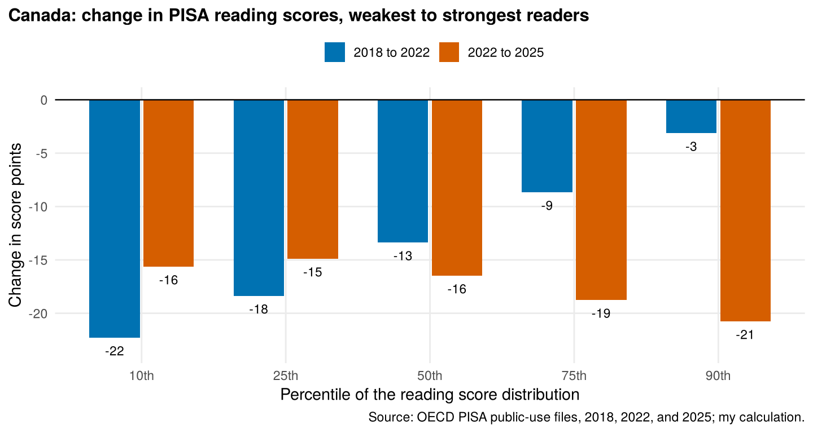
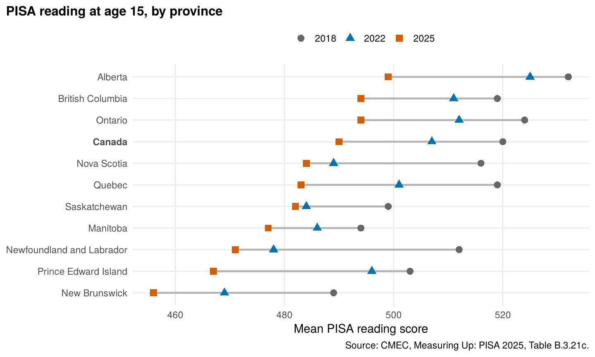

In an [earlier post](../one-in-three-cannot-read/index.qmd) I looked at the provincial figures behind the claim that one in three 9-year-old Canadians cannot read, and I said I would write again about the international tests. This post does that. It uses the public student files from PISA, the OECD's assessment of 15-year-olds, for 2018, 2022, and 2025 [1], and the PIRLS Grade 4 files for 2016 and 2021 [3].

My estimates reproduce the published ones. For Canada in 2022 I obtain a reading mean of 507 with a standard error of 2.0, and for Alberta on PIRLS 2021 a mean of 539 with a standard error of 3.6. Both match the official reports [2, 3].

## The decline did not stop in 2022

| | 2018 | 2022 | 2025 |
| :--- | ---: | ---: | ---: |
| Mean reading score | 520 | 507 | 490 |
| Below Level 2 | 13.8% | 18.1% | 21.8% |

: PISA reading, Canada. Level 2 is the OECD's baseline of proficiency. {#tbl-canada}

The mean fell 13 points from 2018 to 2022 and a further 17 points from 2022 to 2025. Both changes are several times their standard errors, with the link error between cycles included.

The 2022 result was widely read as the cost of the pandemic. If school closures were the whole story, the three years after 2022 should show a pause or a partial recovery. They show a second drop at least as large as the first.

## The two drops are not the same

{fig-alt="Grouped bar chart. From 2018 to 2022 the change was minus 22 points at the 10th percentile, minus 18 at the 25th, minus 13 at the median, minus 9 at the 75th, and minus 3 at the 90th. From 2022 to 2025 the change was minus 16, minus 15, minus 16, minus 19, and minus 21."}

From 2018 to 2022, the weakest readers lost the most. The score at the 10th percentile fell 22 points, and the score at the 90th percentile fell 3, a change that is within sampling error. That pattern is what an interruption of schooling would produce if stronger students were better able to keep learning without it.

From 2022 to 2025, the loss was about the same everywhere: 15 to 21 points at every percentile I examined. Strong readers, who had held their ground through the pandemic years, fell as far as weak ones.

I do not know what caused the second drop. The data rule out some explanations, which I take up below, and they do not identify one.

## The provinces fell at different times

{fig-alt="Dot plot of mean PISA reading scores for Canada and the ten provinces in 2018, 2022, and 2025. Every province is lower in 2025 than in 2018. Alberta moves from 532 to 525 to 499, Ontario from 524 to 512 to 494, Quebec from 519 to 501 to 483, Newfoundland and Labrador from 512 to 478 to 471, and New Brunswick from 489 to 469 to 456."}

Every province scored lower in 2025 than in 2018 [2]. The timing differs.

- Newfoundland and Labrador, Nova Scotia, and Saskatchewan took most of their decline by 2022 and changed little afterward.
- Alberta, British Columbia, and Prince Edward Island changed little by 2022 and fell afterward. Alberta fell 26 points between 2022 and 2025.
- Quebec, Ontario, and New Brunswick fell in both periods. Manitoba fell by 8 and 9 points, the smallest total decline along with Saskatchewan's.

The provincial figures for 2025 are CMEC's. The public file for 2025 does not identify provinces within Canada, so I could not recompute them.

## Three explanations the data do not support

*A change in who is in the classroom.* I reweighted the 2025 sample so that the shares of non-immigrant, second-generation, and first-generation students match those of 2018. The 2025 mean moves from 490 to 492. Immigration does not explain a 30-point decline.

*A change in who wrote the test.* About 77% of sampled students took part in both 2022 and 2025, and Statistics Canada found that the students who took part had higher school marks than those who did not [2]. That biases each year's score upward. It biases the change only if the bias itself changed. For the 17-point drop to be an artefact, the gap between participants and non-participants would have had to shrink by about 75 points in three years, with participation unchanged. The OECD's own review reached the same view and called the effect on the 2022 to 2025 comparison negligible [2].

*The pandemic alone.* The cohort tested in 2025 was in Grade 4 or 5 when schools closed in 2020, so lasting harm from the closures is possible. A closure effect, however, would be expected to look like the first drop and fall hardest on weak readers. The second drop does not look like that.

## In Grade 4, where a comparison exists, there is no drop

Quebec is the only province with its own PIRLS sample in both 2016 and 2021. Its Grade 4 mean was 547 in 2016 and 551 in 2021, a difference within sampling error. The share of students below the Low benchmark was 1.6% and 1.2%.

In 2021, the share below the Low benchmark was 5.0% in Alberta, 5.7% in British Columbia, and 7.5% in Newfoundland and Labrador. The share below the Intermediate benchmark, which is the figure the Aristotle Foundation report used for Alberta [4], was 20%, 21%, and 26%.

One province and one pair of years is thin evidence. It is still worth setting beside the 15-year-old results: the largest measured declines are in adolescence, and the public debate is about how reading is taught in Grades 1 to 3.

## What this does not show

It does not show why scores fell after 2022. The candidates people raise, among them phones, attendance, and the long tail of the closures, are not tested here.

It does not show that the 2025 numbers are exact. Canada did not meet the PISA standard for student participation in 2022 or 2025, and seven provinces carry a caution flag in 2025 [2]. The levels are probably somewhat too high in both years. The change between them is on firmer ground than either level.

It does not bear on the early-reading reforms. A student who started Grade 1 under Alberta's new curriculum in 2022 will be 15 in about 2031.

## What would settle it

The 2025 public file has no province codes for Canada. With them, the percentile analysis above could be done province by province, and one could see whether Alberta's late drop looks like Newfoundland's early one. CMEC holds those codes.

PIRLS 2026 was written last spring. Its results, due in December 2027, will give Grade 4 figures that can be set against 2021 for more provinces than Quebec.

The R scripts behind these numbers are available on request. If you find an error, please [tell me](mailto:consulting@rckaruna.ca).

## References

1. OECD. [PISA database](https://webfs.oecd.org/pisa2022/index.html): student questionnaire data files, 2018, 2022, and 2025.
2. Elez V, et al. [*Measuring Up: Canadian Results of the OECD PISA 2025 Study*](https://cmec.ca/Publications/Lists/Publications/Attachments/448/PISA_2025_Public_Report_EN.pdf). Council of Ministers of Education, Canada, 2026. Tables B.3.21c and B.3.21d, and Appendix A.
3. IEA TIMSS & PIRLS International Study Center. [PIRLS 2021 International Database](https://pirls2021.org/?p=6868) and [PIRLS 2016 International Database](https://timssandpirls.bc.edu/pirls2016/international-database/index.html).
4. Livingstone D, Hunt D, Tran P. [*One in Three 9-Year-Old Canadians Cannot Read*](https://aristotlefoundation.org/wp-content/uploads/2026/11/26-11-13_Livingstone_Hunt_Reality-Check_One-in-three-9-year-olds-cannot-read.pdf). Aristotle Foundation for Public Policy, November 13, 2026.
