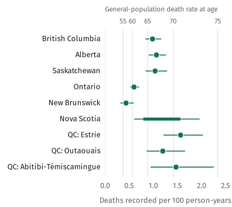
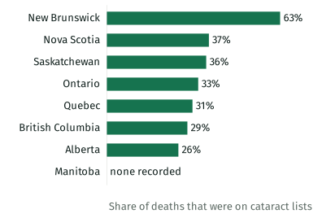
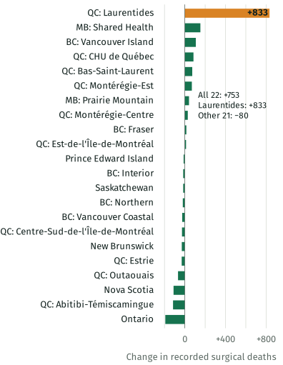

In November 2026 SecondStreet.org reported 29,468 cases in 2025-26 in which a surgery, procedure, diagnostic scan, or specialist appointment was cancelled because the patient had died [1]. CTV News carried it as at least 29,000 Canadians who died while waiting [2]. Its video report added that deaths among people waiting for surgery had risen 17.5% in a year [3].

Waits for care in Canada are long, and some people die because care came too late. That deserves attention. The question I ask here is narrower: what can this count support? I went through the freedom-of-information responses that SecondStreet posted with its report, and I set the counts beside published waiting-list sizes and Statistics Canada life tables. The [full report](waitlist-deaths-interim-report.pdf) runs to 35 pages [10]. It is preliminary and has not been peer reviewed. This post gives the main findings.

## The count has no ages

None of the 34 documents gives the age of a single patient. The requests did not ask for it.

Age matters because people on surgical and imaging lists are mostly older, and older people die at known rates whether or not they are waiting. In British Columbia in 2024, the chance of dying within a year was 0.8% at age 65, 2.0% at age 75, and 6.1% at age 85 [6]. Of the people who had a knee replacement in BC, 72% were 65 or older and 29% were 75 or older [7]. A count of deaths among people on a list therefore needs a benchmark: the number of deaths expected in a group of the same size and age over the same period. Nobody has made that comparison for this count, because the ages are missing.

The count is also a count of cancelled bookings, and one person can hold several. Vancouver Coastal Health's imaging table has 1.23 bookings per patient, and one Quebec health body lists 532 waits for 459 patients. Of the 29,468 cases, 5,931 are surgeries and procedures. The other 23,537 are scans and requests to see a specialist.

## Death rates on surgical lists, read as ages

One comparison needs no ages. Divide the deaths recorded on a surgical list by the number of people waiting through the year, and the result is a death rate. A life table then gives the age at which the general population dies at that rate.

The five regional health authorities in BC recorded 900 deaths in 2025-26 on lists that averaged about 91,500 cases through the year [5]. That is 0.98 deaths per 100 person-years of waiting, the rate at which British Columbians aged 67 die. The table gives the same calculation wherever a list size is published.

| Province or region | Deaths | Rate | Age |
| :--- | ---: | ---: | ---: |
| British Columbia | 900 | 0.98 | 67 |
| Alberta | 878 | 1.07 | 67 |
| Saskatchewan | 317 | 1.04 | 65 |
| Ontario | 1,291 | 0.60 | 61 |
| New Brunswick | 91 | 0.43 | 54 |
| Nova Scotia | 127 to 250 | 0.79 to 1.56 | 62 to 69 |
| Quebec: Estrie | 162 | 1.57 | 71 |
| Quebec: Outaouais | 78 | 1.20 | 68 |
| Quebec: Abitibi-Témiscamingue | 37 | 1.47 | 70 |

: Deaths recorded on surgical waiting lists in 2025-26. Rate is deaths per 100 person-years on the list. Age is the age at which the general population of that province dies at that rate. Nova Scotia's count is a range because 41 of its rows are withheld as fewer than five. Manitoba and Prince Edward Island publish no list size. The list sizes are in the report [10], and those for the Quebec regions are from the provincial waiting-list file [9].

{fig-alt="Dot plot of deaths recorded per 100 person-years on surgical waiting lists. British Columbia, Alberta, and Saskatchewan sit near 1.0, between the general-population rates at ages 65 and 70. Ontario is at 0.60 and New Brunswick at 0.43, below the rate at age 60. Three Quebec regions are between 1.2 and 1.6."}

Alberta is the most informative row. It is the one province that finds these deaths by linking its waiting list to dates of death, and it counts people, not bookings. Its rate is the general-population rate at age 67, the same age as in BC.

The low rates need a caution. New Brunswick's is the rate of the general population at age 54, and that more likely means its registry misses deaths than that its patients are that young.

## Where ages are known, fewer deaths were recorded than age alone predicts

Knee replacement is the one list for which I have real ages, because CIHI publishes them [7]. Given those ages, the BC life table predicts 131 to 150 deaths in a year among the people waiting for a knee replacement in four BC health authorities. Those authorities recorded 56.

Two things could produce that gap, and the counts cannot separate them. People accepted for a knee replacement are healthier than others of their age. Booking offices also do not learn of every death. The result holds unless the people waiting are nine to ten years younger than the people who had the operation.

For surgery as a whole I had to assume the ages, and the comparison is sensitive to what I assume, so I put little weight on it.

## The provinces are not counting the same thing

The recorded rates in the table differ nearly fourfold. The responses show why they would.

**Cataract surgery.** Patients waiting for cataract surgery are 63% of New Brunswick's count and 26% to 37% of the count in six other provinces. Manitoba's main response has no cataract cases at all.

{fig-alt="Bar chart of the cataract share of classified surgical-list deaths by province: New Brunswick 63%, Nova Scotia 37%, Saskatchewan 36%, Ontario 33%, Quebec 31%, British Columbia 29%, Alberta 26%, and Manitoba none recorded."}

**One number in Quebec.** Half of Quebec's surgical total, 967 of 1,879, is a single figure from the Laurentides region for "surgical intervention or medical act." Set against that region's surgical list, it would be 11 deaths per 100 person-years, the rate at which the general population dies at age 88.

**Scans ordered near the end of life.** Ontario released 9,085 CT and MRI bookings that were cancelled because the patient died. Among the 754 with a two-day target, 46% were cancelled within a day of the order. Those are urgent scans, most likely for very sick patients, and they are in the count beside people who waited for months. Most of the Ontario bookings did wait: 82% had been open longer than their target when they were cancelled.

## The 17.5% rise comes from one health region

SecondStreet's brief says that, among health bodies that provided data in both years, surgical waitlist deaths rose 17.5% [1]. The figure can be reproduced from the tables in its 2025 and 2026 briefs [1, 4]. Twenty-two health bodies have a surgical count in both tables, with 4,300 cases in 2024-25 and 5,053 in 2025-26.

| Health bodies | 2024‑25 | 2025‑26 | Change |
|:---|---:|---:|---:|
| All 22 with a surgical count in both years | 4,300 | 5,053 | +17.5% |
| Laurentides, Quebec | 134 | 967 | +622% |
| The other 21 | 4,166 | 4,086 | −1.9% |
| The 12 outside Quebec | 3,280 | 3,174 | −3.2% |

: Surgical cases cancelled because the patient died, in the health bodies behind the 17.5% figure.

{fig-alt="Bar chart of the change in recorded surgical deaths for 22 health bodies. Laurentides in Quebec rose by 833. No other body changed by more than about 200 in either direction. Ten bodies rose and twelve fell. All 22 together rose by 753, and the 21 other than Laurentides fell by 80."}

The count for Laurentides rose by 833. The net rise across all 22 bodies is 753. Without Laurentides, the count fell.

The Laurentides figure for 2025-26 is the "surgical intervention or medical act" number described above, and the response says it includes endoscopy. The region's figure for 2024-25 gives 1.3 deaths per 100 person-years, in line with other regions of Quebec. Its surgical list was 15% smaller in the second year. A sevenfold rise in deaths on a shrinking list is not credible as a change in mortality. The likelier explanation is that the two responses cover different sets of patients, and only the health body can confirm that.

The other bodies do not share a trend either. Across the 22, counts rose in 10 and fell in 12. Ontario Health says of its own imaging count that the change from year to year is driven mainly by how hospitals record cancelled entries. In BC, where the list size is known in both years, the rate went from 0.92 deaths per 100 person-years to 0.98, on a list of the same size. That is the general-population rate at age 66, and then at age 67.

The headline number itself rose from 23,746 to 29,468. Almost all of that rise is a change in what was reported.

| Source of the change in the headline number | Cases |
|:---|---:|
| Figures reported in both years | +295 |
| Figures new in 2025-26 | +8,560 |
| Figures from 2024-25 that dropped out | −3,133 |
| Change in the total | +5,722 |

: Where the rise from 23,746 to 29,468 comes from. The new figures are Alberta's surgical count and specialist and diagnostic counts from five Quebec health bodies.

## What this does not show

None of this shows that waiting is harmless. The counts cannot say how many of these deaths the wait caused, and that is true in both directions. Some registries appear to miss deaths, so the number of people who died while waiting could be higher than recorded. A study of Ontario patients waiting for bypass surgery found that they died at about three times the rate of the general population of the same age [8]. That study could say so because it had each patient's age and time on the list.

SecondStreet's brief makes a related point: no government analysed how many of these cases involved a delay that contributed to the death [1]. It cites the one review I know of, by Nova Scotia for 2022-23, in which 50 of 532 waiting-list deaths involved procedures where delay might reasonably have played a part.

My own estimate of the ages, from a model that weights each waiting list by life-table mortality, is that 60% to 74% of the surgical-list deaths were of people aged 75 and over. It rests largely on assumed ages and is the least secure result in the report.

I take no position here on how health care should be delivered or paid for. The argument is about what one count can show.

## What would settle it

A province can answer the question with one table: the number of people who died while on a surgical or imaging list, by age group, procedure, and priority, found by linking the list to death registrations, and set beside the number expected from the life table. Alberta already does the linkage.

On November 25 I asked the five BC regional health authorities for their counts by age group. I will write again when the answers arrive.

SecondStreet posted every response it received, and that is what made this check possible. If you find an error in the report, please [tell me](mailto:consulting@rckaruna.ca).

## References

1. Craig C. *Died on a Waiting List, 2026 Edition.* Policy brief. SecondStreet.org, November 2026. [Brief (PDF)](https://secondstreet.org/wp-content/uploads/2026/11/Policy-Brief-Died-on-a-Waiting-List-Craig-WEB-final.pdf). [Freedom-of-information responses](https://secondstreet.org/2026/11/25/died-on-a-waiting-list-2026-report/).
2. Wright H. [At least 29,000 Canadians died over last year while waiting for medical procedure, scan or specialist](https://www.ctvnews.ca/health/article/at-least-29000-canadians-died-over-last-year-while-waiting-for-medical-procedure-scan-or-specialist/). CTV News, November 2026.
3. CTV News. [At least 29,000 Canadians died over last year while waiting for medical procedure](https://www.youtube.com/watch?v=JoZkjgu88X8). Video, November 2026.
4. Craig C. [*Died on a Waiting List, 2025 Edition*](https://secondstreet.org/wp-content/uploads/2025/11/Policy-Brief-Died-on-a-Waiting-List-2025-Edition.pdf). Policy brief. SecondStreet.org, November 2025.
5. BC Ministry of Health. [BC Surgical Wait Times](https://catalogue.data.gov.bc.ca/dataset/bc-surgical-wait-times), annual file, 2009/10 to 2025/26.
6. Statistics Canada. [Table 13-10-0837-01](https://www150.statcan.gc.ca/t1/tbl1/en/tv.action?pid=1310083701). Life expectancy and other elements of the complete life table.
7. Canadian Institute for Health Information. [*Hip and Knee Replacements in Canada: CJRR Annual Report, 2024–2025*](https://www.cihi.ca/sites/default/files/document/hip-knee-replacements-in-canada-cjrr-annual-report-2024-2025-en.pdf).
8. Naylor CD, Szalai JP, Katic M. [Benchmarking the vital risk of waiting for coronary artery bypass surgery in Ontario](https://www.cmaj.ca/content/162/6/775). *CMAJ* 2000;162(6):775–779.
9. Ministère de la Santé et des Services sociaux. [Chirurgies: portrait de la liste d'attente](https://www.donneesquebec.ca/recherche/dataset/chirurgies-portrait-de-la-liste-d-attente). Données Québec.
10. Karunanayaka RC. [*Deaths on waiting lists in British Columbia, 2025–26: what the published counts show without patient ages*](waitlist-deaths-interim-report.pdf). Interim report, third version, November 25, 2026. It lists the sources for the other provinces' list sizes.
